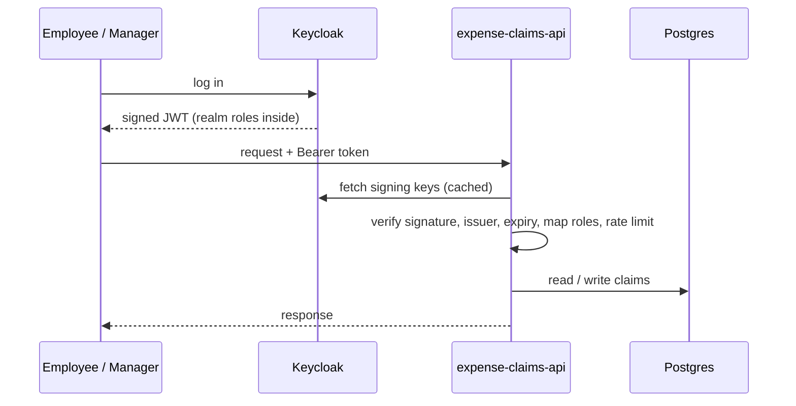

# expense-claims-api

[](https://github.com/nagarjuna-thumma/expense-claims-api/actions/workflows/build.yml)

A small expense claims API in Kotlin and Spring Boot, secured with OAuth2 and JWTs issued by Keycloak.

Employees submit claims and managers approve or reject them. The business side is simple on purpose. The point of the project is the authorization rules around it, which is where real APIs tend to leak data.



## The rules

| Who | Can do |
|---|---|
| Employee | Submit a claim, list their own claims, view a claim they own |
| Manager | Everything above, plus list pending claims, view any claim, approve or reject |
| Anyone | Nothing without a valid token (401) |

A few details that matter more than they look:

- **Viewing someone else's claim returns 404, not 403.** A 403 would confirm the id exists. This is the classic IDOR check, and it lives in the service, not just in an annotation.
- **Managers can't approve their own claims**, even though their role allows approving in general. Role checks alone can't express that rule, so it's checked against the claim's owner.
- **A claim can only be decided once.** Approving an already rejected claim returns 409.
- **Rate limiting is per user, not per IP.** The filter runs after the token is verified and keys the limit on the JWT subject. Over the limit you get a 429 with a `Retry-After` header.
- **Keycloak roles are mapped explicitly.** Keycloak puts realm roles in `realm_access.roles`, which Spring doesn't read by default. `KeycloakRoleConverter` turns them into `ROLE_EMPLOYEE` and `ROLE_MANAGER`.

## Running it

You need Java 21 and Docker.

```bash
docker compose up -d     # Postgres on 5433, Keycloak on 8180 with the "expenses" realm imported
./gradlew bootRun        # API on 8080
```

The realm comes with three test users: `alice` (employee), `carol` (employee) and `bob` (employee and manager). Each user's password is the same as their username.

Get a token and call the API:

```bash
TOKEN=$(curl -s http://localhost:8180/realms/expenses/protocol/openid-connect/token \
  -d grant_type=password -d client_id=expenses-cli -d username=alice -d password=alice | jq -r .access_token)

curl -s -X POST localhost:8080/claims -H "Authorization: Bearer $TOKEN" \
  -H 'Content-Type: application/json' -d '{"description":"Taxi to client site","amount":42.50}'

curl -s localhost:8080/claims/mine -H "Authorization: Bearer $TOKEN"
```

The password grant is enabled on the `expenses-cli` client only to make local testing easy. A real front end would use the authorization code flow with PKCE.

## Endpoints

| Method | Path | Role |
|---|---|---|
| POST | `/claims` | employee |
| GET | `/claims/mine` | any logged-in user |
| GET | `/claims/{id}` | owner or manager |
| GET | `/claims/pending` | manager |
| POST | `/claims/{id}/approve` | manager (not own claim) |
| POST | `/claims/{id}/reject` | manager (not own claim) |

Errors come back as RFC 7807 problem details.

## Tests

```bash
./gradlew test
```

- `KeycloakIntegrationTest` starts a real Keycloak with Testcontainers, logs in as alice and bob, and checks that real signed tokens work, roles are enforced, and a tampered token is rejected.
- `ClaimApiTest` runs the whole app against a real Postgres, with test JWTs, and covers each rule in the table above.
- `RateLimiterTest` and `KeycloakRoleConverterTest` are plain unit tests.

GitHub Actions runs everything on every push.

## Stack

Kotlin 2.2 · Spring Boot 3.5 · Spring Security OAuth2 Resource Server · Keycloak 26 · PostgreSQL · Flyway · Testcontainers · Gradle (Kotlin DSL) · GitHub Actions

## What I'd change for production

- Move the rate limit buckets to Redis so the limit holds across instances
- Add an audit log of who approved what, written in the same transaction as the decision
- Use the authorization code flow with PKCE for a real front end and turn off the password grant
- Add pagination to the list endpoints
